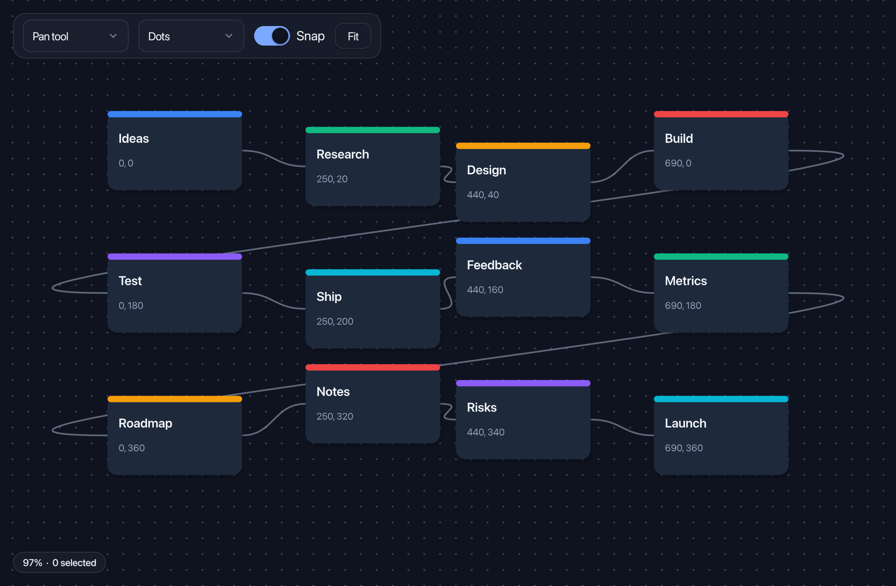
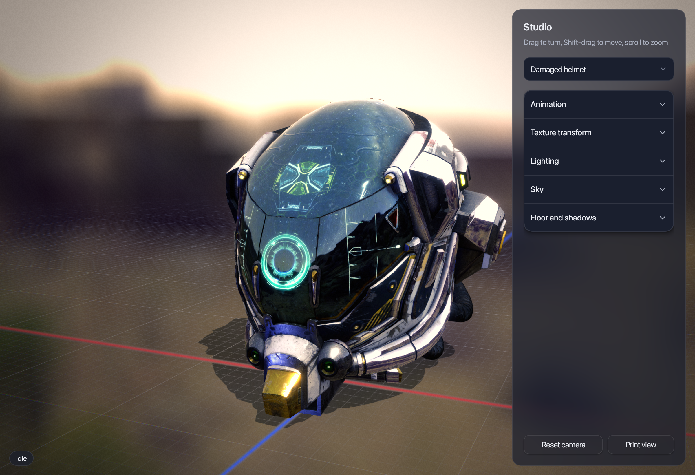

# ashui-canvaskit

Interactive 2D canvases and 3D viewports for ashui. Use `<canvas-kit>` for
boards, diagrams and editors, or `<scene-kit>` for mesh and glTF scenes.
Both compose with HXX controls and share ashui's layout, clipping and opacity.

## Setup

```sh
haxelib install ashui-canvaskit
```

This installs ashui and its dependencies. Use [Ash](https://ash.rayzor.tech/#setup)
to run the compiled app. Save this as `build.hxml`:

```hxml
-lib ashui-canvaskit
--macro ashui.ui.Markup.enable()
-main CanvasDemo
-hl bin/canvas.hl
```

## 2D example

Save as `CanvasDemo.hx`, then run `haxe build.hxml` and `ash bin/canvas.hl`:

```tsx
import ashui.app.WindowedApp;
import ashui.canvaskit.CanvasKit;
import ashui.reactive.Reactive;
import ashui.types.Brush;

class CanvasDemo {
    static function main() {
        WindowedApp.run({title: "Canvas", width: 640, height: 480}, () -> {
            var items = signal([{id: "card", x: 80.0, y: 80.0}]);
            var normal = Brush.solid(0x64748b);
            var selected = Brush.solid(0x3b82f6);
            return <canvas-kit width={640} height={480} tool={Select} snap={16.0}
                draw={(ctx, kit) -> for (item in items.get()) {
                    ctx.fillRect(item.x, item.y, 120, 80,
                        kit.selection.has(item.id) ? selected : normal, 12);
                    kit.region(item.id, item.x, item.y, 120, 80);
                }}
                onDrag={(ids, dx, dy) -> items.set([for (item in items.get())
                    {id: item.id, x: item.x + (ids.contains(item.id) ? dx : 0),
                        y: item.y + (ids.contains(item.id) ? dy : 0)}])} />;
        });
    }
}
```

The draw callback uses content coordinates; pan and zoom are applied for you.
Register selectable objects with `kit.region()`. The kit reports drag deltas;
your application updates its data, as above.

| Interaction | Behavior |
| --- | --- |
| Empty left drag | Pan by default; marquee selection with `tool={Select}` |
| Middle/right drag | Pan, with momentum on release |
| Wheel | Zoom around the pointer |
| Shift-wheel or horizontal scroll | Pan |
| Click / Shift-click / Cmd or Ctrl-click | Select / add / toggle |
| Shift-drag empty space | Marquee selection |

Supply `Viewport2D` and `Selection2D` to share or control view state. Use
`snap` for a drag grid, `kit.visible()` to skip objects outside the view,
and `kit.fitContent()` to ease the view around all or selected regions.
`Background2D` provides dots, grid, crosshatch or no pattern.

## 3D scenes

Inside your app's UI builder:

```tsx
import ashui.canvaskit.Geometry;
import ashui.canvaskit.SceneKit;

var box = Geometry.box();
return <scene-kit width={640} height={480} antialias={true}
    draw={ctx -> ctx.drawMesh(box)} />;
```

`SceneKit` supplies an orbit camera and default lighting. Drag to orbit,
Shift-drag or right-drag to pan, and scroll to zoom. Supply `OrbitCamera`
to control or share camera state; `controls={false}` disables camera input.

### Selection and gizmos

Pass `Selection3D` for selected-object tools and `worldGizmo={true}` for
the world axes in the top-right corner. `gizmoMode` accepts `GizmoMode.Orbit`
(the default), `GizmoMode.Scale` or `GizmoMode.Move`, including signals and computed values:

```tsx
import ashui.canvaskit.GizmoMode;
import ashui.canvaskit.Selection3D;
import ashui.math.Mat4;
import ashui.math.Quat;
import ashui.math.Vec3;
import ashui.reactive.Reactive;

var selection = new Selection3D();
var rotation = signal(Quat.IDENTITY);
var scale = signal(Vec3.ONE);
var position = signal(Vec3.ZERO);
var mode = signal(GizmoMode.Orbit);
var rotate = (delta:Quat) -> rotation.set(delta.mul(rotation.get()).normalize());
var resize = (delta:Vec3) -> scale.set(scale.get().mul(delta));
var move = (delta:Vec3) -> position.set(position.get().add(delta));
return <scene-kit selection={selection} gizmoMode={mode} worldGizmo={true}
    width={640} height={480} draw={ctx -> {
        var at = Mat4.compose(position.get(), rotation.get(), scale.get());
        selection.draw("box", ctx, () -> ctx.drawMesh(box, at));
        selection.region("box", box.min, box.max, at, rotate, null, resize, move);
    }} />;
```

Click an object's registered bounds to select it; an empty click clears
selection. In **Orbit** mode, drag red **X**, green **Y** or blue **Z** rings
to rotate about world axes; the outside ring rotates in the view plane.
Set `mode.set(GizmoMode.Scale)` to show local-axis scale grips. Drag an axis
to stretch it, or the center grip up and right to scale uniformly.
Set `mode.set(GizmoMode.Move)` to show world X/Y/Z translation arrows. Drag an
arrow to move along that axis, or the center grip to move in the camera plane.
An end-on arrow remains reachable and maps pointer distance to world units at
the original pivot depth.
**Escape**, losing focus or changing selection or mode cancels a drag and
restores its transform. Clicking a positive or negative world axis sets
the camera's view, keeping its target and distance. Dragging elsewhere
still orbits or pans the camera.

Register bounds through the same transform used to draw the object. Picking
uses oriented bounds, rather than individual triangles. The rotation callback
receives a quaternion delta in world space; the application keeps its own
transform state. The scale callback receives positive multipliers for local
X/Y/Z, so scaling preserves the object's rotation. The optional `pivot`
argument to `region()` sets a world pivot other than the object's origin;
`onScale` follows it, then optional `onMove` receives world-space translation
deltas. Register only visible objects; bounds are refreshed
when the scene draws. Omit a callback to keep the object selectable
without handles for that tool. `kit.gizmos.transforming` identifies a captured
object gesture; `onTransformEnd` receives `false` when it commits or `true`
when canceled. An editor can use these to group a drag into one undo entry.

Wrap the object's mesh or model draws in `selection.draw(id, ctx, draw)`
to give the selected object a subdued blue mask, a soft rim and highlighted
silhouette edges. The mask reduces material color and lighting contrast,
including emissive bloom, so the gizmo stays prominent over detailed surfaces.
The object's shape and texture detail remain visible, edges use the scene's
depth, and the gizmos draw above them. Geometry is cached while
selected and freed on deselection. Cutout and blended materials keep the
surface treatment without geometry edge lines. Custom shaders inherit the
mask and rim when they use `MeshShader.fragment`; their vertex deformation
is preserved, and geometry edge lines are skipped.

`worldGizmoRight` and `worldGizmoTop` adjust the corner inset (16 layout units
by default), so a floating panel can leave the widget visible. The widgets
draw reactively and keep no idle ticker. Try the
[SceneGizmos demo](https://github.com/rayzor-blade/ashui/blob/main/tools/demo/SceneGizmos.hx)
or select a model in Studio3D.

- **Geometry and assets:** `Geometry` builds primitives, terrain and
  `lathe` surfaces turned from a profile; `Gltf.load()` reads glTF/GLB models. `GltfPose` and `GltfAnimation` handle
  node transforms, skins, morph targets and animation playback.
- **Lighting:** configure lights and ambient strength, use `Environment`
  for HDR lighting, `Skybox` for a visible sky and `GroundGrid` for a floor.
  Directional lights can cast shadows.
- **Effects:** exposure, fog, bloom, color grading, vignette, grain,
  chromatic aberration, lens distortion, motion blur and FXAA.

### Modelling smooth shapes

A `Cage` models a shape that primitives cannot, such as a car's body. You
place a few hundred points and join them into faces. Catmull-Clark
subdivision then smooths the cage into a surface. Creases keep chosen edges
sharp, such as a shoulder line or a window's edge. Each face has a material
slot, so one surface can be partly paint and partly glass:

```haxe
import ashui.canvaskit.Cage;
import ashui.draw3d.Material;
import ashui.math.Vec3;

var cage = new Cage();
// The right half of the shape: every point at x >= 0, the middle line at x = 0.
var a = cage.add(new Vec3(0, 0, 0)), b = cage.add(new Vec3(1, 0, 0));
var c = cage.add(new Vec3(1, 1, 0)), d = cage.add(new Vec3(0, 1, 0));
cage.face([a, b, c, d], 0);         // counter-clockwise seen from outside, slot 0
cage.crease(b, c);                  // a hard edge; crease(b, c, 2) softens after two levels
var surface = cage.mirrored().subdivided(3);
var meshes = surface.meshes([new Material({baseColor: 0xc8ccd2, metallic: 0.6}),
    new Material({baseColor: 0x10151d, roughness: 0.2})]);
```

`grid` joins rows of points into quads. An edge with only one face is an
opening, such as a wheel arch, and keeps its outline. `surface.band(path,
width, lift)` lays a strip along the surface for a lamp, trim or a panel
line; `surface.closest(p)` gives the surface point nearest `p` and its
normal. `Spline` draws a smooth curve through points, for profiles and
character lines.

## Reactive drawing

Signals read by a draw callback become dependencies. Changes to those signals,
the viewport or camera request a new frame. Set `animate={true}` when content
needs continuous frames; call `repaint()` on a `CanvasKit` reference when
external GPU content changes. Use `paint` for a custom GPU pass at the canvas's
position in the UI paint order.

## Gallery

[Canvas2D](https://github.com/rayzor-blade/ashui/blob/main/tools/demo/Canvas2D.hx)
combines a connected board with pan, zoom, selection, snapping and HXX controls:



[Studio3D](https://github.com/rayzor-blade/ashui/blob/main/tools/demo/Studio3D.hx)
combines glTF rendering, HDR lighting and a frosted panel of reusable controls.
The accordion sections start collapsed:



Helmet by [theblueturtle_](https://sketchfab.com/models/b81008d513954189a063ff901f7abfe4)
(CC BY-NC); HDR sky from Poly Haven (CC0).

The [source](https://github.com/rayzor-blade/ashui/tree/main/canvaskit/haxe/ashui/canvaskit) documents individual APIs and props.

Licensed under [Apache 2.0](https://github.com/rayzor-blade/ashui/blob/main/LICENSE).
