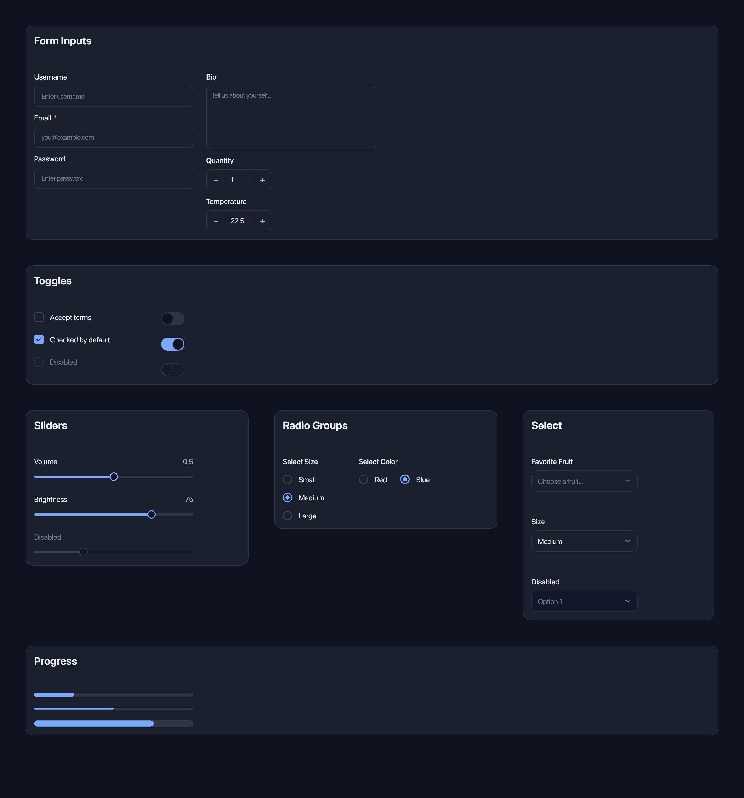
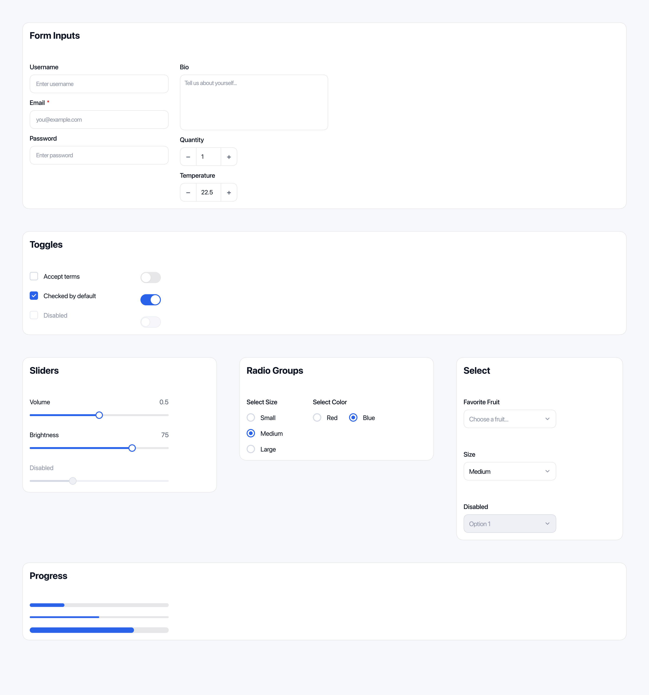
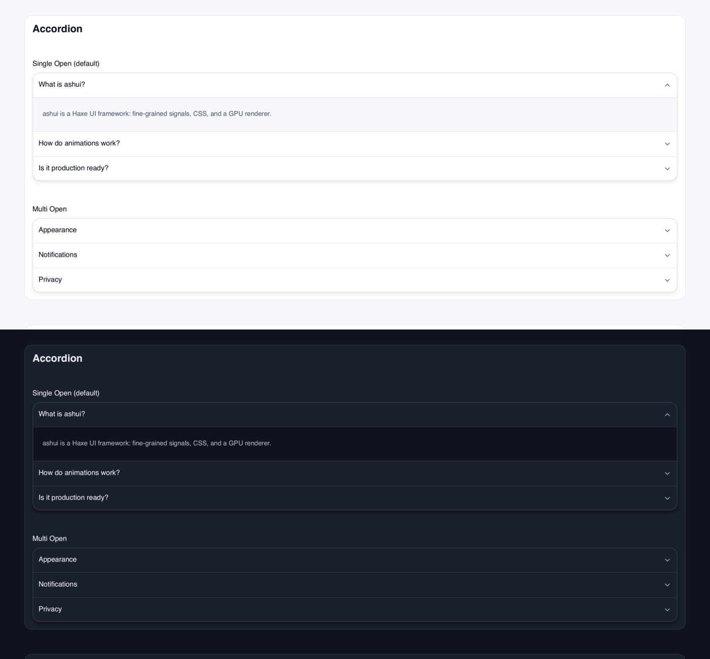
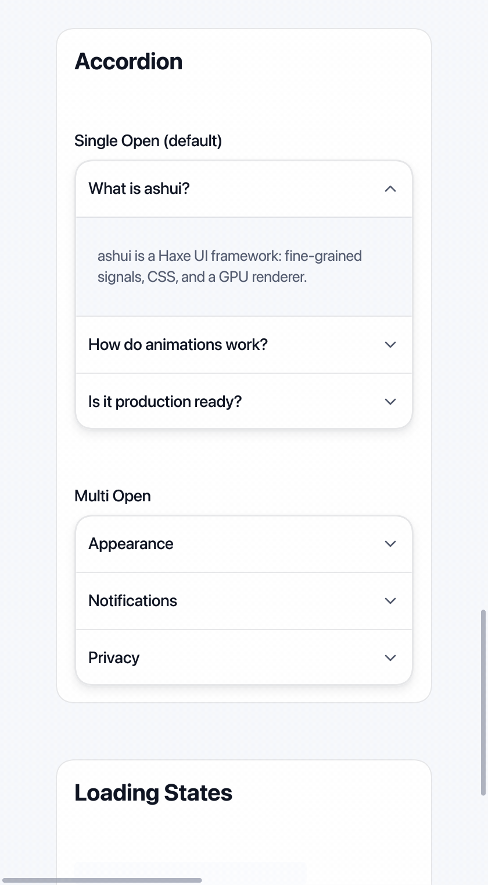

# ashui-components

Reusable controls built from ashui elements. Components bring their keyboard,
focus, pointer and dismissal behavior, with a shared CSS and theme vocabulary.
Compose them as typed HXX tags and customize their appearance with CSS.

## Setup

```sh
haxelib install ashui-components
```

This installs ashui and its dependencies. Use [Ash](https://ash.rayzor.tech/#setup)
to run the compiled app. Save this as `build.hxml`:

```hxml
-lib ashui-components
--macro ashui.ui.Markup.enable()
-main ComponentsDemo
-hl bin/components.hl
```

## Example

Save as `ComponentsDemo.hx`, then run `haxe build.hxml` and `ash bin/components.hl`:

```tsx
import ashui.app.WindowedApp;
import ashui.components.Button;
import ashui.components.Card;
import ashui.components.ToggleSwitch;
import ashui.reactive.Reactive;

class ComponentsDemo {
    static function main() {
        WindowedApp.run({title: "Preferences", width: 420, height: 280}, () -> {
            var notifications = signal(true);
            return <div class="p-6 bg-background" width={420} height={280}>
                <card>
                    <card-header>
                        <card-title>Notifications</card-title>
                        <card-description>Choose when to hear from us.</card-description>
                    </card-header>
                    <card-content class="flex items-center justify-between">
                        <text>${notifications.get() ? "Enabled" : "Disabled"}</text>
                        <toggle-switch checked={notifications} />
                    </card-content>
                    <card-footer>
                        <button type="button" variant={Outline}
                            onClick={_ -> notifications.set(true)}>Reset</button>
                    </card-footer>
                </card>
            </div>;
        });
    }
}
```

Import the component module to use its tags: `Card` brings `<card>` and its
parts, including `<card-header>` and `<card-title>`.

## State and behavior

Pass a signal to editable props such as `checked`, `value` or `open` to share
state with the control. User edits write back to that signal; changing it in
your code updates the control. Constants set initial state, while computeds
let a control follow derived state. Change callbacks report the events
documented by each component.

Buttons support focus, Enter and Space. Form buttons default to submitting;
use `type="button"` for other actions. Dialogs manage modal focus and restore
it on close; popovers and menus handle their own navigation and dismissal.
`DialogContent` also accepts `closedby`, `onCancel` and `onClose`. Forms with
`method="dialog"` validate and close their containing dialog; `Button.value`
supplies the return value. See the [dialog and form guide](https://github.com/rayzor-blade/ashui/blob/main/docs/elements.md).

## Controls

| Area | Components |
| --- | --- |
| Forms | Input, Textarea, NumberInput, NumberGauge, NumberRangeGauge, InputOtp, Checkbox, RadioGroup, ToggleSwitch, Slider |
| Selection | Select, Combobox, Calendar with `minYear` and `maxYear` |
| Overlays | Dialog, Sheet, Drawer, Popover, Tooltip, HoverCard, Toast |
| Navigation | Command, Tabs, Accordion, DropdownMenu, ContextMenu, Menubar, TreeView, Sidebar |
| Content | Card, Badge, Avatar, Alert, Table, Chart, Progress, Spinner, Skeleton |
| Layout | ScrollArea, Resizable, AspectRatio, Separator |

Each [component source](https://github.com/rayzor-blade/ashui/tree/main/components/haxe/ashui/components) documents its props, parts,
events and CSS hooks.

## Gallery

The existing [FormsGallery](https://github.com/rayzor-blade/ashui/blob/main/tools/snapshot/scenes/FormsGallery.hx)
shows fields, switches, sliders, radio groups, selects and progress in the default theme.

| Dark | Light |
| --- | --- |
|  |  |

The accordion section of
[ComponentsGallery](https://github.com/rayzor-blade/ashui/blob/main/tools/snapshot/scenes/ComponentsGallery.hx)
shows single and multiple open sections in both schemes:



The same gallery at a compact width, scrolled to its accordion section,
records content expansion, chevron rotation and the movement of the following items:



Browse [ComponentsGallery](https://github.com/rayzor-blade/ashui/blob/main/tools/snapshot/scenes/ComponentsGallery.hx)
for buttons, badges, cards, alerts, tabs and loading states.

## Styling

The [component stylesheet](https://github.com/rayzor-blade/ashui/blob/main/components/css/components.css) loads automatically below
application CSS. Parts have `ui-` classes, such as `.ui-button` and
`.ui-switch-thumb`. Variants and sizes use `data-variant` and `data-size`;
interactive states use selectors such as `:hover`, `:checked` and
`:focus-visible`.

`Input`, `Textarea`, `Select`, `Combobox`, `InputOtp`, `Checkbox`,
`RadioGroup`, `Slider` and `Badge` accept the shared `Size` enum: `Sm`,
`Md` (default) and `Lg`. Sizes adjust typography, spacing and internal
parts together, including dropdown options, checkbox marks and slider thumbs.
Radio items inherit the group's size and can override it individually.

```tsx
import ashui.components.Input;
import ashui.components.Select;
import ashui.components.Slider;

var field = <input size={Sm} placeholder="Search" />;
var choice = <select size={Lg} value="design">
    <select-item value="design">Design</select-item>
</select>;
var volume = <slider size={Md} label="Volume" value={0.5} />;
```

Input, select and combobox heights are 32/40/48 px; textarea defaults are
88/120/152 px high, with explicit `width` and `height` supported. CSS overrides
also update editable text's caret and wrapping geometry. Run FormsGallery
with `SIZES=1` to compare all nine controls in either color scheme.
The size gallery supplies a monospace font fallback for a native SF Mono
rendering defect; the components themselves keep the theme's font token.

### Tabs

`TabsList` draws one selection background beneath its triggers. It slides
and resizes to the selected tab on clicks, keyboard navigation and bound
`value` changes, using the framework's FLIP layout animation and the theme's
motion tokens. Rapid choices continue from the background's current
position. The existing trigger and content behavior stays in place.

```tsx
import ashui.components.Tabs;
import ashui.reactive.Reactive;

var section = signal("overview");
var view = <tabs value={section}>
    <tabs-list>
        <tabs-trigger value="overview">Overview</tabs-trigger>
        <tabs-trigger value="activity">Activity</tabs-trigger>
        <tabs-trigger value="shortcuts">Keyboard shortcuts</tabs-trigger>
    </tabs-list>
    <tabs-content value="overview">Your workspace at a glance.</tabs-content>
    <tabs-content value="activity">Recent changes.</tabs-content>
    <tabs-content value="shortcuts">Keyboard shortcuts.</tabs-content>
</tabs>;
```

Style `.ui-tabs-indicator` or set `--ui-tabs-active-bg` and
`--ui-tabs-trigger-radius`. `<tabs-list indicator={false}>` uses a stationary
background on the active trigger. The
[TabsMotion scene](https://github.com/rayzor-blade/ashui/blob/main/tools/snapshot/scenes/TabsMotion.hx)
compares all three sizes in either theme and supports interactive window mode.

### Switch knob icons

`ToggleSwitch` places its HXX children inside the knob. A single inline SVG
stays visible in both states. For an animated change, keep two SVGs mounted
with the `ui-switch-icon-off` and `ui-switch-icon-on` classes:

```tsx
import ashui.components.ToggleSwitch;
import ashui.reactive.Reactive;

var enabled = signal(false);
var control = <toggle-switch checked={enabled}>
    <svg class="ui-switch-icon-off" viewBox="0 0 24 24" fill="none"
        stroke="currentColor" stroke-width="2" stroke-linecap="round">
        <path d="m6 6 12 12M18 6 6 18" />
    </svg>
    <svg class="ui-switch-icon-on" viewBox="0 0 24 24" fill="none"
        stroke="currentColor" stroke-width="2" stroke-linecap="round"
        stroke-linejoin="round">
        <path d="m5 12 4 4L19 6" />
    </svg>
</toggle-switch>;
```

The icons fade, rotate and scale with the theme's animation tokens, while
the knob slides as usual. They stay centered in `Sm`, `Md` and `Lg`, add no
focus stop, and pass clicks to the switch. Customize `--ui-switch-icon-size`
and `--ui-switch-icon-color`, or replace the CSS transitions. This animates
the two SVG elements; it does not interpolate their path data.

### Commands

Import `ashui.components.Command` for the command palette and its parts.
Ordinary HXX `<for>` and `<if>` children participate in filtering, group
visibility and selection, including when their data changes.

```tsx
import ashui.components.Command;
import ashui.reactive.Reactive;

var tools = signal(["Calendar", "Calculator", "Settings"]);
var palette = <command onSelect={value -> trace(value)}>
    <command-input placeholder="Search tools" />
    <command-list>
        <command-empty>No results</command-empty>
        <command-group heading="Tools">
            <for {tool in tools.get()}><command-item value={tool}>{tool}</command-item></for>
        </command-group>
    </command-list>
</command>;
```

Arrows, Home and End reveal the selected row while focus stays in the search
field. Manual scrolling stays where you leave it until selection, filtering
or the catalog changes. See [CommandMotion](https://github.com/rayzor-blade/ashui/blob/main/tools/snapshot/scenes/CommandMotion.hx).

### Input icons

Place an `input-icon` inside `Input` to add a leading SVG. Set
`side={Trailing}` for an icon after the text. Both sides resize with the
field and leave room for its placeholder, text and caret.

```tsx
import ashui.components.Input;

var search = <input type="search" placeholder="Search projects">
    <input-icon>
        <svg viewBox="0 0 24 24" fill="none" stroke="currentColor"
            stroke-width="2" stroke-linecap="round" stroke-linejoin="round">
            <circle cx="10" cy="10" r="7" />
            <path d="m21 21-6-6" />
        </svg>
    </input-icon>
</input>;
```

Icons are decorative: clicking them focuses the field, and Tab reaches
the input once. Editing, validation and form submission use the existing
input behavior; Escape clears a search. Use a `button` child for an
interactive action. Style `.ui-input-icon[data-side]` or set
`--ui-input-icon-size`, `--ui-input-icon-gap` and `--ui-input-icon-color`.

### Numeric inputs

`NumberInput` uses the shared `Size` enum. Medium is the default; large
keeps its original 40 px design. Buttons, arrow keys and the wheel share
the same decimal steps and bounds. Wheel up increases the value; trackpad
movement accumulates into steps. Disabled fields let their parent scroll.
An ongoing parent scroll keeps its gesture when a numeric control moves
under the pointer, including momentum; those deltas never edit the value.
Moving onto a control or waiting for the 250 ms wheel gap lets a new gesture
edit it without scrolling its parent.
The field and step buttons resize together:

```tsx
import ashui.components.NumberInput;

var small = <number-input size={Sm} value={12.5} step={0.5} />; // 24 px
var medium = <number-input size={Md} value={12.5} step={0.5} />; // 32 px (default)
var large = <number-input size={Lg} value={12.5} step={0.5} />; // 40 px
var field = <number-input showStepButtons={false} value={12.5} step={0.5} />;
```

Set `showStepButtons={false}` to omit the minus/plus buttons. Integers and
decimals stay centered; typing, arrow keys and wheel stepping remain enabled.

`NumberGauge` shows a filled range, a centered number and a vertical SVG three-dot
grip. `NumberRangeGauge` fills the interval between two grips. Drag or scroll
near an edge to edit it; Tab reaches each endpoint separately for arrow,
Page Up/Down and Home/End keys. Both support the same `Sm`, `Md` and `Lg`
heights as NumberInput. They stay compact: the formatted minimum, maximum
and decimal step determine their maximum width in the current font.
Intervals reserve space for both values. Changing the value does not resize
the control, and narrower parents can shrink it.

```tsx
import ashui.components.NumberGauge;
import ashui.components.NumberRangeGauge;
import ashui.reactive.Reactive;

var opacity = signal(64.0);
var lower = signal(20.0), upper = signal(75.0);
var amount = <number-gauge value={opacity} min={0} max={100}
    format={n -> n + " %"} />;
var interval = <number-range-gauge lower={lower} upper={upper}
    min={0} max={100} step={0.5} format={(a, b) -> a + " – " + b + " °C"} />;
```

Endpoints stay on the step grid and cannot cross. `onChange` reports user
edits; programmatic changes update the fill and label without calling it.
Use `name` on NumberGauge, or `lowerName`/`upperName` on NumberRangeGauge,
to submit values in a form. `lowerId`/`upperId` let labels target individual
endpoints. `disabled` also follows disabled fieldsets. CSS hooks include
`--ui-number-gauge-width`, `-height`, `-radius`, `-fill`, `-track`, `-font-size`
and `-grip-width`. `--ui-number-gauge-min-width` and `-value-space` tune the
intrinsic sizing; an explicit CSS `max-width` overrides the derived limit.
See the pure HXX
[NumberGauges demo](https://github.com/rayzor-blade/ashui/blob/main/tools/demo/NumberGauges.hx).

Override theme tokens for a shared look, or component properties such as
`--ui-button-bg` and `--ui-card-radius` for a local change. Standard layout
attributes and Tailwind-style classes apply to component roots.

See [CalendarMotion](https://github.com/rayzor-blade/ashui/blob/main/tools/snapshot/scenes/CalendarMotion.hx),
[SortableList](https://github.com/rayzor-blade/ashui/blob/main/tools/demo/SortableList.hx) and the
[component tests](https://github.com/rayzor-blade/ashui/blob/main/tests/Components.hx) for larger compositions.

Licensed under [Apache 2.0](https://github.com/rayzor-blade/ashui/blob/main/LICENSE).
