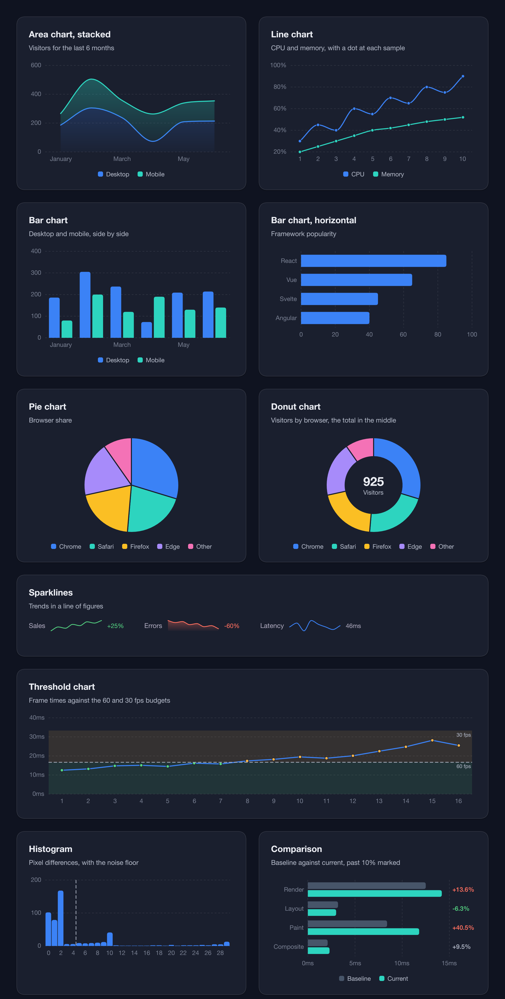
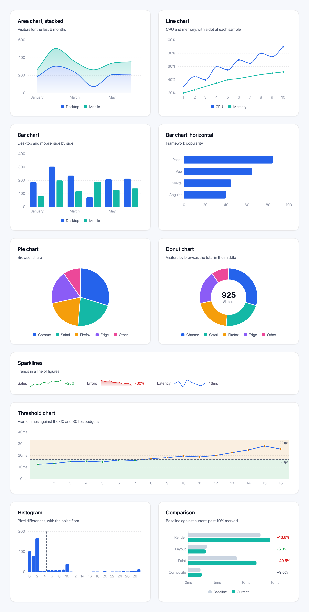
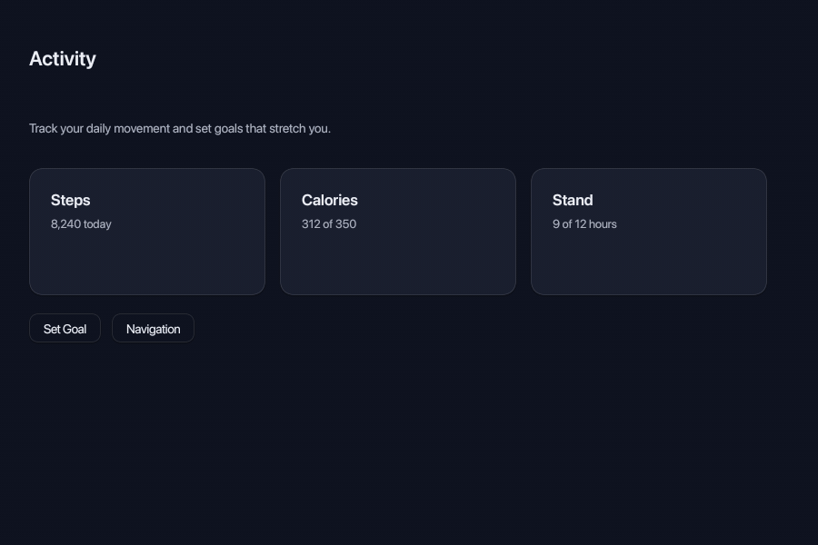
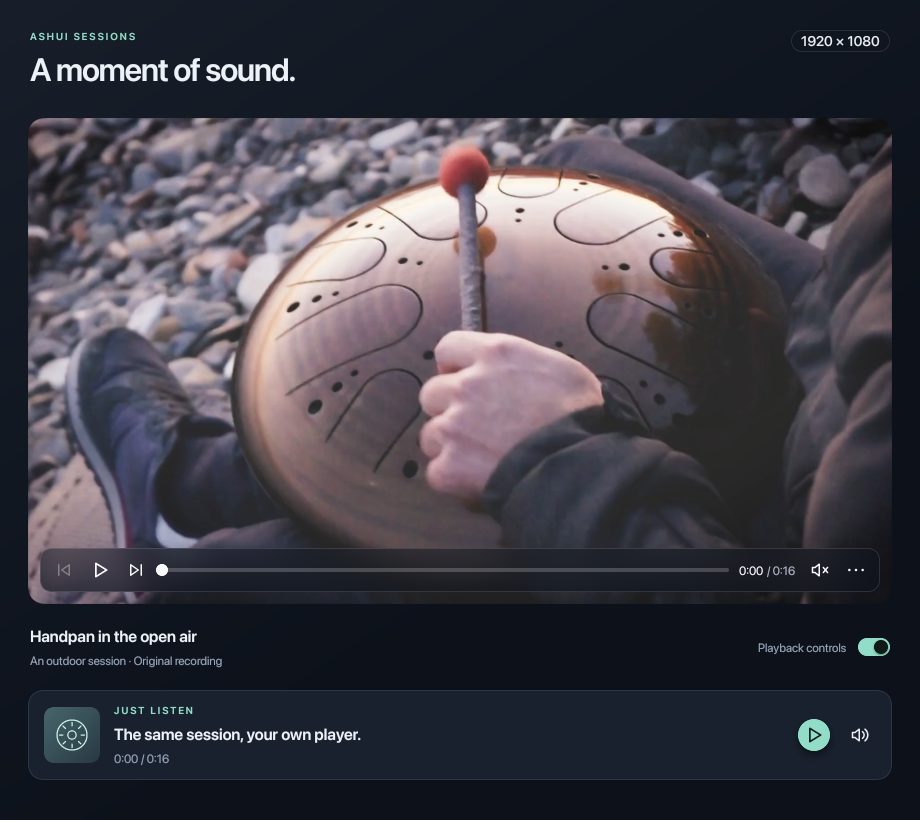

# Showcase and demos

[Back to the README](../README.md)

## Default theme: Hybrid

The same [chart gallery](https://github.com/rayzor-blade/ashui/blob/main/tools/snapshot/scenes/ChartsGallery.hx)
with themed cards, typography and charts in both schemes:

| Dark | Light |
| --- | --- |
|  |  |

## Motion

Native captures of the existing demos: drawer transitions and spring return,
plus the component gallery's single and multiple accordions in a compact view.

| [DrawerMotion](https://github.com/rayzor-blade/ashui/blob/main/tools/snapshot/scenes/DrawerMotion.hx) | [ComponentsGallery](https://github.com/rayzor-blade/ashui/blob/main/tools/snapshot/scenes/ComponentsGallery.hx) |
| --- | --- |
|  |  |

## Canvas and media

| [Studio3D](https://github.com/rayzor-blade/ashui/blob/main/tools/demo/Studio3D.hx) | [MediaPlayback](https://github.com/rayzor-blade/ashui/blob/main/tools/demo/MediaPlayback.hx) |
| --- | --- |
|  |  |

Helmet by [theblueturtle_](https://sketchfab.com/models/b81008d513954189a063ff901f7abfe4)
(CC BY-NC); HDR sky from Poly Haven (CC0).

## Repository demos and tests

Browse the [demos](https://github.com/rayzor-blade/ashui/tree/main/tools/demo)
and [snapshot scenes](https://github.com/rayzor-blade/ashui/tree/main/tools/snapshot/scenes)
for more examples. The repository's
[offscreen runner](https://github.com/rayzor-blade/ashui/blob/main/tools/snapshot/run.sh)
captures PNGs offscreen; `--watch` captures again when a scene,
styles or framework change. These development tools live in the source
repository, rather than the installed packages.

[ashui in a page](web.md) runs a program in the browser through Ash's WebAssembly target, drawn with WebGPU.

[Icons](icons.md) are typed constants compiled into the program, from the Remix catalogue or your own SVG files.

[Visual debugging](debugging.md) includes native hit maps, exact
pointer paths, motion trails, easing curves and filmstrips.

See [desktop windows and menus](windows.md) for multiple windows, window-local services and application menus.
