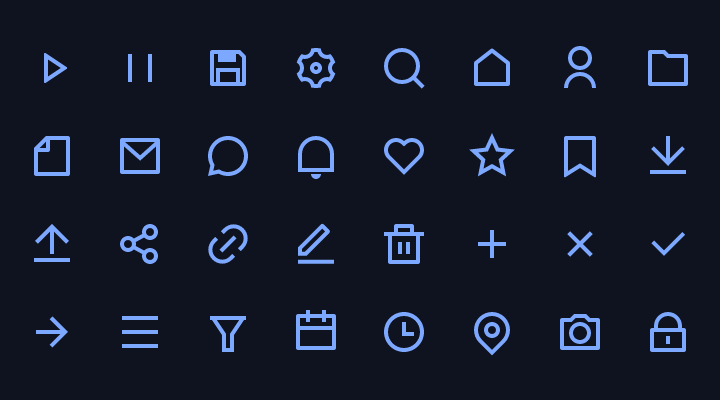
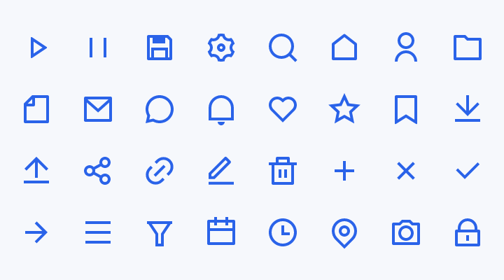

# ashui-icons

The [Remix](https://remixicon.com) icon set as typed
[ashui](https://github.com/rayzor-blade/ashui) constants, plus a macro for
building custom sets from SVG directories. Icons are validated and embedded
at compile time. The app needs no runtime icon files and includes only
the icons it references.

|  |  |
| --- | --- |

## Setup

```sh
haxelib install ashui-icons
```

This also installs ashui. Run the compiled app with
[Ash](https://ash.rayzor.tech/#setup). Add `ashui-components` for the `<icon>`
element and enable HXX in `build.hxml`:

```hxml
-lib ashui-icons
-lib ashui-components
--macro ashui.ui.Markup.enable()
-main IconsDemo
-hl bin/icons.hl
```

## Use

Save as `IconsDemo.hx`, then run `haxe build.hxml` and `ash bin/icons.hl`:

```tsx
import ashui.app.WindowedApp;
import ashui.components.Icon;
import ashui.icons.Remix;

class IconsDemo {
    static function main() {
        WindowedApp.run({title: "Icons", width: 320, height: 120}, () ->
            <div class="flex flex-row items-center justify-center gap-4 p-6 text-primary" width={320} height={120}>
                <icon document={Remix.PLAY_LINE} class="size-6"/>
                <icon document={Remix.PAUSE_LINE} class="size-6"/>
                <icon document={Remix.SAVE_3_LINE} class="size-6 text-success"/>
            </div>);
    }
}
```

Remix icons use `currentColor`, so they inherit the surrounding text color
or their own `text-*` utility. The default size is 24 pixels. Override it
with utilities such as `size-6` or `w-5 h-5`.

Each constant is an `ashui.svg.SvgDocument`, which also fits a component prop typed
`ashui.svg.Icon`, such as a tree item's `icon`.

## Names

Constant names come from uppercase filenames, with punctuation replaced by
underscores. Names starting with a digit receive a leading underscore:

- `play-line.svg` → `Remix.PLAY_LINE`
- `save-3-line.svg` → `Remix.SAVE_3_LINE`
- `4k-line.svg` → `Remix._4K_LINE`

`-line` and `-fill` variants are separate icons. Category folders organize
files under `ashui/icons/remix` but do not affect constant names.

## A set of your own

`ashui.svg.IconSet.build` generates constants from one or more SVG directories.
Combine Remix and application icons in one class:

```haxe
@:build(ashui.svg.IconSet.build(["ashui/icons/remix", "assets/icons"]))
class Icons {}

var move = Icons._3D_MOVE; // assets/icons/3d-move.svg
var play = Icons.PLAY_LINE;
```

Directories resolve through Haxe class paths. Add the parent of `assets/icons`
with `-cp`. Missing directories, malformed XML, invalid paths and duplicate
constant names produce compile errors at the source file.

SVG files are compiler dependencies, so the compilation server rebuilds the
class when they change. Use `currentColor` to make custom icons follow text color.

## Licence

The ashui packages are under the Apache License 2.0. The icons are Remix Icon
4.8.0 by Remix Design, [remixicon.com](https://remixicon.com), the last version
under the Apache License 2.0 as well; its text is in
[`ashui/icons/remix/LICENSE`](https://github.com/rayzor-blade/ashui/blob/main/icons/haxe/ashui/icons/remix/LICENSE)
and ships with the package. Later versions of Remix Icon are under a different
licence, with terms about distributing the icons as a collection, so this package
stays on 4.8.0.
